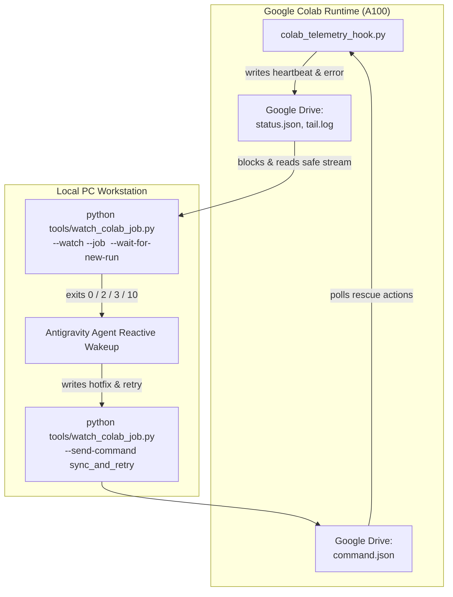

# Colab Training Sentinel & Remote Rescue Runbook (`colab-training-watch`)

This skill defines the operational standard for monitoring, hotfixing, and landing models trained on remote Google Colab GPU runtimes (e.g. A100-SXM4) through Google Drive for Desktop synchronization.

---

## Architecture Overview

Google Colab instances write real-time heartbeats, logs, and artifacts to mounted Google Drive storage (`<drive_data_root>/colab_runs/<job_name>/`). The local sentinel script [watch_colab_job.py](../../../tools/watch_colab_job.py) monitors these files without polling LLM tokens, blocking in the background until the job reaches a terminal or interactive rescue state.



---

## Core Rules for Agents

### Rule 1: Zero-Token Blocking Waiting
> [!IMPORTANT]
> **NEVER use `schedule` timers or subagent polling loops to check Colab training progress.**
> Doing so wastes LLM generation tokens on identical status checks every few minutes.

Instead, execute the local blocking sentinel via `run_command` and **immediately conclude your turn**:

```powershell
python tools/watch_colab_job.py --watch --job m4_router --wait-for-new-run
```

- Pass `WaitMsBeforeAsync: 1000` and `IsDaemon: false`.
- End your turn immediately. The sentinel process will silently sleep in the background, consuming **0 LLM tokens** for the entire 30–180 minute training session.
- When Colab finishes, fails, or pauses for rescue, the background process terminates and the Antigravity system automatically wakes you with the complete output and exit code.

### Rule 2: Zero-Baggage Remote Hotfix on Exit Code `10`
When `watch_colab_job.py` wakes you with **exit code `10`** (`[COLAB_WAITING_FOR_FIX]`):
1. **Diagnosis**: The wakeup output already contains the structured JSON status, the exact Python traceback, and recent lines from `tail.log`.
2. **Subagent Delegation**: If the fix requires multi-step code inspection or hypothesis testing, delegate the fix to a clean subagent (`invoke_subagent(TypeName="self", Model="inherit")`) to avoid bloating your main conversation history.
3. **Dispatch Remote Hotfix**: Once local scripts (e.g. under `training/` or `tools/`) are corrected, push the hotfixed code to Drive and instruct Colab to retry the stage without reloading the runtime or GPU models:

```powershell
python tools/watch_colab_job.py --job m4_router --send-command sync_and_retry --note "Fixed batch OOM by lowering per_device_train_batch_size to 2"
```

> [!TIP]
> `--send-command sync_and_retry` automatically runs `--sync-repo` first to incrementally mirror `training/` and `tools/` into `<drive_root>/repo_sync/`, writes `command.json` atomically, and signals the waiting Colab cell to resume immediately.

4. **Resume Sentinel**: Immediately re-launch the blocking watch sentinel to put yourself back to sleep:
```powershell
python tools/watch_colab_job.py --watch --job m4_router
```

### Rule 3: Artifact Landing on Exit Code `0`
When `watch_colab_job.py` exits with **code `0`** (`[COLAB_SUCCEEDED]`), proceed to land the produced artifacts into the local workspace:

- **M3 ASR Model (`m3_asr`)**:
  - Source path on Google Drive: `<drive_data_root>/models/asr-personal-v2/model.int8.onnx`
  - Target local path: `models/asr-personal-v2/model.int8.onnx`
  - Validation: Verify file size and test with the local ASR inference engine.
- **M4 Natural Language Router (`m4_router`)**:
  - Source path on Google Drive: `<drive_data_root>/router_m4/export/dvo-qwen3-4b-router-q4_k_m.gguf`
  - Target local path: `models/router/dvo-qwen3-4b-router-q4_k_m.gguf`
  - Local Registration:
    ```powershell
    ollama create dvo-router -f training/router/Modelfile.dvo-router
    ```

---

## Sentinel Exit Codes Reference

| Exit Code | Signal Header | Description & Recommended Agent Action |
| :--- | :--- | :--- |
| **`0`** | `[COLAB_SUCCEEDED]` | Training completed successfully. Land artifacts according to Rule 3. |
| **`10`** | `[COLAB_WAITING_FOR_FIX]` | Colab encountered a recoverable exception and paused execution. Apply hotfix and run `--send-command sync_and_retry` (Rule 2). |
| **`2`** | `[COLAB_FAILED]` | Non-recoverable failure or unhandled termination. Inspect traceback in output and notify user. |
| **`3`** | `[COLAB_HEARTBEAT_STALE]` | No heartbeat update received for > 300s. Colab runtime may have disconnected or GPU memory kernel hung. |
| **`4`** | `[COLAB_MAX_WAIT_TIMEOUT]` | Hard safety timeout (6 hours) reached. Verify Colab status manually. |

---

## CLI Command Cheat Sheet

```powershell
# 1. Non-blocking status check (prints summary + last 20 lines of log):
python tools/watch_colab_job.py --status --job m4_router

# 2. Start blocking sentinel for a new or current training run:
python tools/watch_colab_job.py --watch --job m4_router --wait-for-new-run

# 3. Incrementally sync local code changes to Drive repo_sync/:
python tools/watch_colab_job.py --sync-repo

# 4. Dispatch in-place retry after fixing code:
python tools/watch_colab_job.py --job m4_router --send-command sync_and_retry

# 5. Dispatch runtime abort:
python tools/watch_colab_job.py --job m4_router --send-command abort

# 6. Verify sentinel implementation integrity:
python tools/watch_colab_job.py --self-test
```
