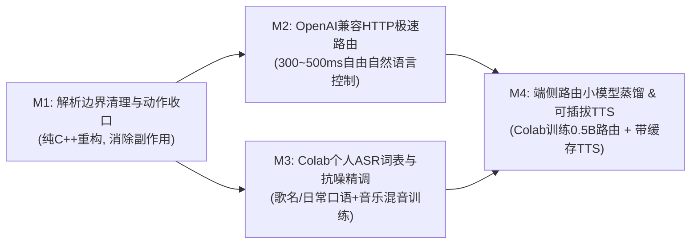

# 从严格命令走向完全自然语言控制：演进路线图与架构评审（2026-11-10）

## 1. 背景与核心结论

在完成第一阶段固定短语命令与本地 SenseVoice 个性化微调（`asr-personal-20260926`）后，下一阶段的目标是将系统从**退而求其次的严格短语匹配**升级为**完全自由的自然语言桌面编排控制**，同时保证**云端能力纯增量可插拔**（随时可切换其他兼容供应商，或在停订/断网时 100% 退回本地离线运行）。

结合 122 条真实录音样本的量化基准测试（详见 [`docs/EVALUATION.md`](EVALUATION.md) 第 10 节）与 Codex 源码级架构交叉审查，确立以下核心演进原则：

1. **声学前端与主 ASR 保持 100% 本地极速推理（~72 ms）**：
   - 实测表明，本地微调后的 SenseVoice INT8 在安静与外放音乐场景下均达到 `26/26 (100%)` 命令正确率、平均延迟 `~71 ms`；而 OpenAI 云端 `gpt-4o-transcribe` 平均网络耗时 `~1700 ms`（慢 23 倍），且在外放音乐场景下会出现背景歌词幻觉及语义改写（如将 `"小克，暂停音乐"` 误听/改写为反向指令 `"小克，打开音乐。"`）。
   - 因此，**绝不用云端 STT 替换本地主解码器**；本地 ASR 对未训练新词（如 `"换歌"`、`"放每日推荐"`、`"顺序播放"`）的短板，直接利用 Google Colab 算力进行第二轮扩词与抗噪精调（`asr-personal-v2`）解决。
2. **语义理解采用“本地规则快通道 + 可插拔 LLM 慢通道”双轨架构**：
   - 高频固定短语继续走本地确定性规则（`< 2 ms`）；
   - 自由口语、点歌搜歌手、多步复合指令、ASR 同音错字容错，通过轻量级 OpenAI 兼容 HTTP 路由器（`gpt-4o-mini` / `gpt-4.1-mini` Structured Outputs 或端侧蒸馏 `Qwen2.5-0.5B/1.5B`）在 `300~500 ms` 内完成结构化动作规划。
3. **规划与执行严格解耦（Pure Planner + Deterministic Executor）**：
   - 路由器只负责输出受 JSON Schema 约束的动作计划，绝不在路由器内部偷跑 MCP 副作用；所有动作统一交由 C++ `ActionExecutor` 校验并严格保序执行。

---

## 2. OpenAI 语音与文本路由成本核算

| 模型 / 接口 | 官方计费标准 | 折算单价 / 典型开销 | 在本项目中的定位 |
| --- | --- | --- | --- |
| `gpt-4o-transcribe` | \$2.50 / 1M 输入音频 Token + \$10.00 / 1M 输出文本 Token | **约 \$0.006 / 分钟** | 离线对标基线 / 疑难样本离线对照（不做在线主 ASR） |
| `gpt-4o-mini-transcribe` | \$1.25 / 1M 输入音频 Token + \$5.00 / 1M 输出文本 Token | **约 \$0.003 / 分钟** | 离线对标基线 |
| `gpt-4o-mini-tts` | \$0.60 / 1M 输入文本 Token + \$12.00 / 1M 输出音频 Token | **约 \$0.015 / 分钟** | 阶段四（M4）可插拔带本地磁盘缓存的桌面语音播报（TTS） |
| `gpt-4o-mini` / `gpt-4.1-mini`（文本路由） | \$0.15~\$0.40 / 1M 输入 Token | **每次路由约 \$0.00008**（1 万次仅需 ~\$0.8） | 阶段二（M2）主力自然语言命令路由 + 阶段三/四合成训练数据生成 |
| `gpt-realtime` / `gpt-4o-audio-preview` | \$32~\$40 / 1M 输入音频 Token | 约 \$0.06~\$0.24 / 分钟 | 成本高且需常驻上传音频流，不符合本地隐私与低功耗目标，**不采用** |

---

## 3. Codex 源码架构评审意见甄别（采纳 vs 剔除）

针对仓库现有代码（`src/command_parser.cpp`、`src/agy_router.cpp`、`src/streaming_recognizer.cpp`、`src/announcement.cpp`），对 Codex 的审查意见进行了逐行源码核实与工程取舍：

### 3.1 采纳并纳入里程碑的 4 个代码级真问题

1. **问题 1：`src/command_parser.cpp:225-238` 的历史同音纠错表会劫持自然语言**
   - **代码现状**：早期为挽救未微调模型的识别错误，`kPauseMusicConfusions` 硬编码了把 `"想听音乐"`、`"听一下音乐"`、`"再听音乐"` 替换为 `"暂停音乐"`。
   - **实际危害**：开启自然语言控制后，用户说 `"小克，我想听音乐"`，快通道规则会抢在 LLM 路由器之前直接把音乐**暂停**（完全相反的误操作）。
   - **修复方案（M1）**：从 `kPauseMusicConfusions` 中移除语义反转项（`"想听音乐"`、`"听一下音乐"`、`"再听音乐"`、`"在听音乐"`）；同时修正 `parse_llm()`，使传给路由器的请求同时携带原始识别文本与已剥离唤醒词的干净文本。

2. **问题 2：`src/agy_router.cpp:125-137, 873-878` 存在“路由器内偷跑动作 + 覆盖复合指令”的副作用**
   - **代码现状**：当前 `agy` 路由提示词让大模型在路由阶段直接调用 MCP 工具（`dvo_netease_control` / `dvo_netease_search_play`），并在 `src/agy_router.cpp:877` 用 `mcp_actions` 整体覆盖模型返回的 JSON。
   - **实际危害**：
     1. 动作在 `CommandPlan` 校验和入队之前就已经在外部进程执行，破坏了 `dry-run`、动作超时取消和审计边界；
     2. 当用户说出复合自然语言（如 `"小克，先把声音关小点，再放首周杰伦的晴天"`）时，`mcp_actions` 会直接覆盖整条响应，导致前面的“调小音量”动作被吞掉，且执行顺序倒置。
   - **修复方案（M1）**：**路由器只做纯规划（Pure Planner），不执行外部副作用**。在 `include/dvo/command.h` 中扩展参数化动作（如 `ActionType::media_search_play`，携带 `query` 与 `search_type`），统一交由 `WindowsActionBackend` 与网易云 CDP/控制接口保序执行。

3. **问题 3：`src/streaming_recognizer.cpp:760-767` 与 `src/command_parser.cpp:771-774` 的备选解码器串行开销与抢跑**
   - **代码现状**：每次 `exact-final` 都会在循环中无条件串行跑完主解码器（`sense_voice`, ~73 ms）和备选解码器（`zipformer_ctc`, ~112 ms），使单句识别延迟翻倍至 ~185 ms；且在 `hybrid` 模式下，`parse_rules(fallback_alt)` 排在 `parse_llm(primary)` 之前。
   - **实际危害**：当用户说出自然语言（主模型 SenseVoice 准确转出但因不是死板短语未命中 `parse_rules(primary)`），若备选模型 `zipformer_ctc` 恰好将某几个字误听成固定短语，就会抢在自然语言路由器之前错误执行。
   - **修复方案（M1）**：将默认配置中的 `fallback_decoder` 设为 `"none"`（主模型 `asr-personal` 已在安静与音乐测试集达到 100%），消除 112 ms 的无意义串行等待与备选抢跑隐患。

4. **问题 4：`src/announcement.cpp:166-179` 播报门控时机过早**
   - **代码现状**：`AnnouncementDispatcher::Impl::deliver` 在调用 `backend->deliver()` **之前**就发布了 `AnnouncementStatus::playback_started`（在 `src/runtime.cpp:2468` 中触发防自唤醒门控）。
   - **实际危害**：接入网络 TTS 时，等待云端 HTTP 合成的数百毫秒内麦克风也会被提前锁死。
   - **修复方案（M4）**：将 `playback_started` 的发布推迟到音频数据就绪（本地缓存命中读取完成或网络合成返回）、真正启动声卡播放的时刻。

### 3.2 甄别并剔除的 3 个“局部最优 / 过度工程”建议

1. **剔除：“新建异步规划工作线程池 + 跨话语乱序重排状态机 + 重写 `runtime.cpp` 回放空闲门控”**
   - **剔除理由**：桌面单人语音控制是天然的按句串行交互，不存在多用户高并发抢占。为了 300~400 ms 的 HTTP 路由请求去把 `on_final_result` 拆成异步乱序状态机，不仅会破坏 `runtime.cpp` 现有的 `wait_for_idle` 和 `replay`/`evaluate` 确定性回放机制，还会引入跨句并发竞态。在 `ASR worker` 的 `final` 阶段同步调用带严格超时（2.0~2.5 s）的 HTTP 路由器，代码最简、天然保序、100% 兼容现有评测链路。
2. **剔除：“要求先采集 3,000 条负样本 + 30 小时背景噪音以构造泊松分布 95% 置信区间”**
   - **剔除理由**：脱离个人桌面项目实际的教条统计指标。沿用现有的 **52 条标准测试集 + 51 条新说法测试集 + 41 分钟日常背景录音**，再针对自然语言路由补充 **1 组（约 40 条自由说法 + 20 条日常闲聊/否定反例）** 即可构成严密的回归基准。
3. **剔除：“先在本机配置 WSL 做完所有消融实验，再决定是否迁移到 Colab”**
   - **剔除理由**：本机未启用 Hyper-V/WSL，且已有现成的 3,000 Google Colab 计算单元。直接将 `training/asr/finetune.py` 参数化后在 Colab A100/L4 上运行，几分钟即可完成实验与 INT8 模型导出。

---

## 4. 四阶段里程碑与量化验收标准



### 阶段一（M1）：解析器边界清理与参数化动作收口（地基阶段）

- **目标**：清理阻碍自然语言控制的历史硬编码包袱，将“搜歌播放”等带参动作从路由器内部副作用收口到 C++ `ActionExecutor` 统一保序执行。
- **核心任务**：
  1. 修改 `src/command_parser.cpp`：移除 `kPauseMusicConfusions` 中 `"想听音乐"`、`"听一下音乐"`、`"再听音乐"`、`"在听音乐"` 等冲突项；在 `LlmRouteRequest` 中同时传递原始识别文本与剥离唤醒词后的文本。
  2. 修改 `include/dvo/command.h`、`src/command.cpp`、`src/agy_router.cpp` 与 `src/platform/windows/windows_action_backend.cpp`：
     - 新增参数化动作（如 `ActionType::media_search_play`，支持 `search_query` 与 `search_type` 参数）并在 `WindowsActionBackend` 中完成网易云本地执行；
     - 移除 `agy_router.cpp` 用 `mcp_actions` 覆盖复合动作列表的逻辑，使路由器回归纯规划器职责。
  3. 修改 `config/default.toml`：将 `fallback_decoder` 默认值设为 `"none"`，省去每次 `exact-final` 串行执行 `zipformer_ctc` 的 ~112 ms 开销。
- **里程碑验收标准**：
  - `cmake --build --preset release --parallel` 编译零警告通过，`ctest --preset all` 全部单测通过；
  - 新增 `"小克，我想听音乐"` 不误触发暂停、以及 `"小克，先把声音调小5%，再放首周杰伦的晴天"` 复合动作保序规划的单元测试；
  - 现有测试集 `evaluate` 命令正确率不退化，单句 `exact-final` 平均耗时从 `~185 ms` 降至 `~75 ms`；
  - 通过 Codex 代码审查核验。

---

### 阶段二（M2）：可插拔 OpenAI 兼容 HTTP 极速自然语言路由器

- **目标**：用轻量级 C++ HTTP 客户端（WinHTTP）直接对接 OpenAI `/v1/chat/completions`（兼容任意 OpenAI 格式接口，如 DeepSeek、本地 Ollama/vLLM/llama.cpp），将自然语言路由延迟从 CLI 子进程的数秒级压缩至 **300~500 ms**。
- **核心任务**：
  1. 在 `ILlmCommandRouter` 接口下实现 `OpenAiCompatibleCommandRouter`：
     - 默认从系统环境变量 `OPENAI_API_KEY` 读取密钥，严禁将密钥写入日志、配置文件或遥测事件；
     - 支持在 `[commands]` 配置 `router_backend = "openai_compatible" | "agy" | "none"`、`router_base_url`、`router_model`（默认 `gpt-4o-mini`）、`router_timeout_ms = 2500`；
     - 采用 Structured Outputs（严格 JSON Schema）直接输出有序动作数组，支持单句多动作复合规划与闲聊拒识（`actions: []`）。
  2. 扩展 `voice_frontend.exe parse` 与离线评测脚本（`tools/eval_nl_router.py` + `tools/nl_router_eval_60.jsonl` 60 条标准集）以支持自然语言路由基准测试。
  3. 同步落地桌面应用白名单启动动作（`app.open`）与项目内置技能 `.agents/skills/sync-desktop-apps/`（`sync_apps.py` 自动扫描 QuickStart 快捷目录、系统应用及进程并无损写入 `config/local.toml` 的 `[apps]` 段，内置 `Steam`、`Clash`、`Discord`、`QQ`、`PowerShell` 等中英口语与 ASR 谐音别名）。
- **里程碑验收标准**：
  - **快通道耗时**：命中本地固定短语的指令规划耗时 **< 2 ms**；
  - **慢通道（自由自然语言）耗时**：云端 HTTP 路由 P50 **<= 450 ms**，P95 **<= 900 ms**；
  - **准确率与安全性**：在自然语言评测集（40 条含口语改写、多步复合指令、点歌、同音错字的正样本 + 20 条日常闲聊/否定句反例，如 `"这首歌挺好听的"`、`"算了别切歌了"`）上，正样本意图准确率 **>= 95%**，反例误执行率 **= 0%**；
  - **断网/无 Key 安全降级**：未设置环境变量、网络断开或超时时，优雅降级回本地规则，不崩溃、不阻塞后续识别；
  - 通过 Codex 代码审查核验。

---

### 阶段三（M3）：利用 Colab 算力精调个人版通用 ASR 模型（`asr-personal-v2`）

- **目标**：消除本地微调 SenseVoice 对未训练新词（切歌/收藏/日推/播放模式）、常见歌手/歌名及自由口语表达的识别盲区，同时保持音乐外放场景下的高抗噪能力。
- **核心任务**：
  1. 使用 `tools/prepare_voice_prompts.py` 从已有真实录音中筛出无截幅黄金干声参考池，用 `tools/build_nl_tts_prompts.py` 结合本机网易云歌库与中英混说桌面应用指令生成提示语料；通过 `training/asr/synthesize_personal_tts.py`（`CosyVoice2-0.5B` 零样本个人声音克隆 + `SenseVoice` 回环 CER/拼音防失真门控）合成覆盖高频歌手/歌名与自然语言控制句式的增广音频，并用 `tools/mine_game_sessions.py` 挖掘耳机游戏开黑期间由桌面麦克风录制的自然口语与抗误唤醒负样本。
  2. 将 `training/asr/finetune.py`、`training/asr/export.py` 与 `training/asr/evaluate.py` 全量参数化（支持 `--extra-manifests` 与 `--tts-max-per-epoch` 比例上限防合成音过拟合），封装为可在 Google Colab（A100/L4，挂载 Google Drive 数据目录）一键运行的 `training/colab_m3_pipeline.ipynb`，开启 `--unfreeze-encoder-layers 3` 与 0~15 dB 动态背景音乐混音训练。
  3. 导出 `models/asr-personal-v2/model.int8.onnx` 并在本机完成回归评测。
- **里程碑验收标准**：
  - 原 `test_quiet`（26 条）与 `test_music`（26 条）命令正确率保持 **100%（26/26）**；
  - `new_commands_quiet`（51 条新说法）命令正确率从 `92.2% (47/51)` 提升至 **>= 98%（>= 50/51）**；
  - `dev_read` 通用中文句子字错率（CER）从 `11.93%` 降至 **<= 8.0%**；
  - 41 分钟日常背景录音误唤醒与误执行保持 **0 次**，本机 CPU 单句推理耗时保持 **<= 85 ms**。

---

### 阶段四（M4）：端侧路由小模型蒸馏、桌面动作扩展与带缓存 TTS 播报

- **目标**：实现停订云服务或完全离线状态下的 100% 本地自然语言控制，并补齐桌面应用操控与低延迟语音播报闭环。
- **核心任务**：
  1. **Colab 蒸馏端侧路由小模型**：使用 OpenAI 批量生成 20,000 条 `(带 ASR 同音噪点的自然语言文本 -> 受控动作 JSON)` 训练对，在 Colab A100 上微调 `Qwen2.5-0.5B/1.5B-Instruct` 并导出量化模型，通过本地 OpenAI 兼容端点无缝对接 M2 的 `OpenAiCompatibleCommandRouter`（仅需切换 `router_base_url`）。
  2. **桌面控制白名单适配器扩展**：完善 `app.launch`（按配置别名启动常见软件）、`path.open`、窗口置顶/最小化及高风险动作语音二次确认。
  3. **可插拔带缓存 TTS 播报后端（`openai_tts`）**：
     - 修正 `src/announcement.cpp` 门控时序，仅在音频 PCM/WAV 数据准备就绪、即将送入声卡播放时发出 `playback_started`；
     - 实现 `OpenAiTtsAnnouncementBackend`（调用 `gpt-4o-mini-tts`），并以 `sha256(text + voice + model)` 为键在 `data/tts_cache/` 持久化缓存 WAV，使固定反馈语（如“已暂停”、“已收藏”、“正在播放晴天”）只合成一次、后续零网络开销毫秒级播报。
- **里程碑验收标准**：
  - 端侧 0.5B/1.5B 路由模型在 M2 自然语言评测集上准确率与 `gpt-4o-mini` 差距 **<= 2%**，反例误执行率 **= 0%**，本机推理延迟 **<= 150 ms**；
  - 命中本地缓存的 TTS 播报启动延迟 **< 30 ms**，连续播报 100 次 **0 次自唤醒**，断网时自动使用本地缓存或平滑降级为 `log`。

---

## 5. 当前进展与跨机器交接手册（2026-11-11，`develop` 分支）

> **分支管理约定**：所有 M1~M4 的开发统一收敛在远端单分支 **`origin/develop`** 上推进，不再拆分零散特性分支；等 M4 验收通过后再一次性合并回 `main`。

### 5.1 各模块完成状态总览

| 模块 / 任务 | 当前状态 | 核心代码与产物位置 |
| --- | --- | --- |
| **M1 解析边界清理 + `media.search_play`** | **已完成并合入 `develop`**（`4847667`） | `src/command_parser.cpp`（移除 `"再听音乐"->"暂停音乐"` 反转规则）、`config/default.toml`（`fallback_decoder = "none"`）、`include/dvo/command.h`（`ActionType::media_search_play`）、`src/netease.cpp`、`src/netease_cdp.cpp` |
| **M2 WinHTTP OpenAI 兼容路由器 + 60 条评测集** | **代码与离线测试已完成**（`9cff550`），待配置真实 API / 本地推理端跑线上指标 | `include/dvo/openai_router.h`、`src/openai_router.cpp`（Strict JSON Schema + `2500 ms` 硬超时取消 + 环境变量读 Key）、`tests/test_openai_router.cpp`、`tools/nl_router_eval_60.jsonl`、`tools/eval_nl_router.py` |
| **第一层桌面控制：`app.open` + `AppCatalog`** | **已完成并合入 `develop`**（`9cff550`） | `include/dvo/app_catalog.h`、`src/app_catalog.cpp`（`configured` > `quickstart_dirs` > 开始菜单/注册表二级扫描，内置 `powershell`/`steam`/`clash`/`discord`/`qq` 预设）、`src/platform/windows/windows_action_backend.cpp`（`Activate-or-Launch` 窗口激活或启动）、`voice_frontend list-apps` / `act open-app` |
| **`sync-desktop-apps` 工作区 Skill** | **已完成并合入 `develop`**（`9cff550`） | `.agents/skills/sync-desktop-apps/SKILL.md`、`.agents/skills/sync-desktop-apps/scripts/sync_apps.py`（自动探测 `QuickStart`、解析 `.lnk` 含 Discord Squirrel 参数、无损更新 `config/local.toml`） |
| **M3 个人声音克隆 + 游戏录音清洗 + Colab 训练管线** | **脚本与云盘初始语料已就绪**（`4847667` / `9cff550`），待采集今晚游戏会话并上 Colab 训练 | `tools/prepare_voice_prompts.py`、`tools/build_nl_tts_prompts.py`、`tools/mine_game_sessions.py`、`training/asr/synthesize_personal_tts.py`、`training/colab_m3_pipeline.ipynb`；云盘 `desktop-voice-orchestrator-data/m3_tts_prep/` 下已生成 20 条干声参考池及 `pilot_prompts_25.jsonl` / `full_prompts_3600.jsonl` |
| **M4 端侧路由小模型蒸馏 + 带缓存 TTS 播报** | **待启动**（排在 M2 线上实测与 M3 `asr-personal-v2` 导出之后） | 计划修改 `src/announcement.cpp`（修正 `playback_started` 门控时序）并新增本地缓存 TTS 后端与端侧路由蒸馏脚本 |

---

### 5.2 换回另一台机器（如家里主力机）的接手步骤

1. **拉取 `origin/develop`（注意保护本地未提交实验文件）**：
   如果家里的机器此前在旧分支上有未推送的实验代码（例如早期实验性的 `src/agy_router.cpp` 或本地 `config/local.toml` 修改），先做好暂存再切换分支：
   ```powershell
   git fetch origin
   git status -sb
   # 若工作区有未提交的旧实验改动，先 stash 留档（config/local.toml 本身被 gitignore 忽略，不会丢失）：
   git stash push -u -m "backup-home-experimental-before-develop"
   git checkout -B develop origin/develop
   ```

2. **编译最新 `Release` 二进制**：
   ```powershell
   cmake --preset windows-x64
   cmake --build --preset release --parallel
   ctest --preset all --output-on-failure
   ```

3. **同步本机的 `QuickStart` 快捷方式目录与应用路径**：
   可直接让 Agent 触发 `sync-desktop-apps` Skill（例如说“帮我同步本机的 QuickStart 应用到 `local.toml`”），或直接运行：
   ```powershell
   python .agents/skills/sync-desktop-apps/scripts/sync_apps.py --discover-quickstart
   # 确认路径后（例如 D:\QuickStart 或 C:\QuickStart）一键无损写入 config/local.toml：
   python .agents/skills/sync-desktop-apps/scripts/sync_apps.py --scan --quickstart-dir "<你的QuickStart路径>" --write-local-toml
   # 验证 C++ 目录合并结果：
   .\build\windows-x64\Release\voice_frontend.exe list-apps
   ```

4. **实测 M2 自然语言路由（可选，随时可跑）**：
   在终端设置 `OPENAI_API_KEY` 后，既可以直接压测 HTTP 路由准确率/延迟，也可以跑 C++ `voice_frontend.exe` 混合快慢通道端到端验证：
   ```powershell
   $env:OPENAI_API_KEY = "sk-..."
   python tools/eval_nl_router.py --backend openai --model gpt-4o-mini
   # 若在 config/local.toml 中配置了 [commands] parser_mode = "hybrid" 与 router_backend = "openai_compatible"：
   python tools/eval_nl_router.py --backend cpp --parser-mode hybrid
   ```

---

### 5.3 游戏开黑双路语音采集指南（耳麦开黑 + 桌面 ReSpeaker Lite 独立录音）

玩游戏戴耳机时，可以让 **Discord / 游戏语音走耳麦麦克风**（保证队友听得清晰），同时让 **`voice_frontend` 单独绑死桌面上的 ReSpeaker Lite 录音**。这样既无扬声器外放串音，又能采到与日常远场唤醒完全同分布的 ReSpeaker 真实房间声学数据：

1. **查询 ReSpeaker Lite 的设备 ID**：
   ```powershell
   .\build\windows-x64\Release\voice_frontend.exe list-devices
   ```
   复制名称含 `ReSpeaker` 的 `microphone` 设备 `id`（形如 `{0.0.1.00000000}.{xxxx-...}`）。

2. **修改 `config/local.toml` 锁死录音设备并临时关闭动作执行**：
   Windows 系统默认输入设备和语音软件保持选**耳机麦克风**，在 `config/local.toml` 中设置：
   ```toml
   [audio]
   microphone_device = "{0.0.1.00000000}.{刚才复制的ReSpeaker设备ID}"
   follow_default_device = false   # 锁死 ReSpeaker，避免插拔或切换默认耳麦时跟跑

   [commands]
   enabled = false                 # 采集期间关闭实时动作，防止开黑说话误触发切歌或调音量
   ```

3. **启动录制与 45~60 分钟分段保存提醒**：
   - 运行 `.\build\windows-x64\Release\voice_frontend.exe live`，在调试台（`http://127.0.0.1:8765`）将波形切到 **“原始麦克风”**，对着桌面说两句话确认波形跳动正常后点击 **“开始录制”**。
   - **避坑提醒（RIFF WAV 4 GB 上限）**：`FloatWavWriter` 写标准 32-bit float RIFF WAV，单文件上限 4 GB。虽然双声道 `mic.wav` 可连录约 2.5 小时，但如果游戏耳机开启了 **Windows 7.1 虚拟环绕声（8 声道 48 kHz）**，同步写盘的 `loopback.wav` 约 **45 分钟**就会达到 4 GB。建议每打完一两局（约 **45~60 分钟**）切回调试台点一次 **“停止录制” → “开始录制”** 分成 2~3 个 session。
   - 采集结束后，记得将 `config/local.toml` 中的 `commands.enabled` 改回 `true`。

---

### 5.4 Google Drive 数据补齐与 Colab M3 训练流程

在家里机器上跑 Colab 之前，只需把云端硬盘（`desktop-voice-orchestrator-data/`）里缺的两样东西拷进去：

1. **补齐主训练清单**：将家里机器本地的 `dataset/manifest.jsonl` 复制到云端硬盘 `desktop-voice-orchestrator-data/dataset/manifest.jsonl`（云盘上已有 `dataset/clips/` 的 32 个目录与 `dataset/reference/`，唯独缺根目录的 `manifest.jsonl`）。
2. **上传游戏录音会话（可选但推荐）**：将今晚录好的 `data/sessions/<session_id>` 文件夹复制到 `desktop-voice-orchestrator-data/game_sessions/<session_id>`（如果体积大，甚至可以只拷每个会话里的 `mic.wav` 和 `manifest.json`，`mine_game_sessions.py` 只需要 `mic.wav`）。
3. **打开 Colab 一键运行 `training/colab_m3_pipeline.ipynb`**：
   - **Step 1~3**：挂载 Google Drive，先合成并直接在网页里试听 `pilot_prompts_25.jsonl` 的 25 条个人克隆样本（含周杰伦/陈奕迅点歌与 `Steam`/`Clash`/`Discord` 中英混说），确认音色自然、无电音失真；
   - **Step 4**：若上传了游戏会话，自动运行 `mine_game_sessions.py --transcribe`（`SenseVoice` + `faster-whisper large-v3` 双模型逐字一致才放行正样本，不一致自动归入防误唤醒负样本集）；
   - **Step 5~7**：批量合成通过防失真门控的训练音频，运行 `finetune.py`（默认 `--tts-max-per-epoch 1200` 锚定真实人声分布 + 3 层 Encoder 解冻 + 音乐混音增广），导出 `models/asr-personal-v2/model.int8.onnx` 并自动跑完回归评测。
