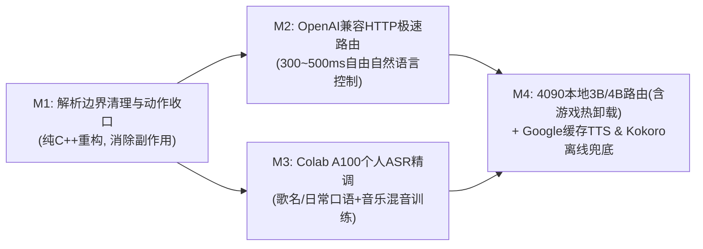

# 从严格命令走向完全自然语言控制：演进路线图与架构评审（2026-11-11 修订）

## 1. 背景、硬件边界与核心结论

在完成第一阶段固定短语命令与本地 SenseVoice 个性化微调（`asr-personal-20260926`）后，下一阶段的目标是将系统从**退而求其次的严格短语匹配**升级为**完全自由的自然语言桌面编排控制**。

结合主力机的真实使用场景——**坐在桌前看书/写字时解放双手的近场操作（Ryzen 7 7800X3D + RTX 4090）**、**充裕的云端算力与赠金（Google Colab 存量 3,000 / 每月 2,000 计算单元 + Google & OpenAI 赠金）**，以及 122 条真实录音基准测试（详见 [`docs/EVALUATION.md`](EVALUATION.md) 第 10 节），确立以下核心架构原则：

1. **“7800X3D CPU 静音守门 + RTX 4090 瞬间拔刀”分工架构**：
   - **声学前端与主 ASR 保持 100% 本地 CPU 极速推理（`~30~70 ms`）**：每 10 ms 持续运行的 VAD/KWS 与微调版 `SenseVoice INT8`（主力机推荐设 `asr.num_threads = 4`，充分利用 7800X3D 的 96 MB 3D V-Cache）全部留在 CPU。这样可确保 RTX 4090 平时处于 **0% 算力负载与 P8 超低功耗待机（~15 W，风扇 0 转完全静音）**，看书/写字时绝无显卡风扇噪音干扰。
   - **绝不用云端 STT 替换本地主解码器**：实测本地微调版 SenseVoice 在安静与音箱外放音乐下均达到 `26/26 (100%)` 命令正确率；而云端 `gpt-4o-transcribe` 网络耗时 `~1700 ms`，且外放音乐下易出现歌词幻觉与反向语义脑补。未训练新词短板直接通过 **Colab A100** 跑第二轮扩词与抗噪精调（`asr-personal-v2`）解决。
2. **自然语言路由采用“本地规则快通道 + 4090 本地 3B/4B / 云端可热切慢通道”**：
   - 高频固定短语继续走本地确定性规则（`< 2 ms`）；
   - **看书/写字模式（默认）**：本机 RTX 4090 常驻加载由 Colab A100 微调导出的 **`Qwen3-4B` / `Qwen2.5-3B-Instruct`（Q4_K_M，仅占 ~2.5~3 GB 显存）**，仅在说话唤醒后爆发推理 **`40~80 ms`** 输出结构化动作计划，比云端 HTTP 路由快 5~8 倍且 100% 离线可用；
   - **游戏模式（一键载入/卸载热切换）**：提供快捷切换入口，一键将模型从 4090 显存彻底卸载归零（`< 0.5 s`），同时利用热参数无缝将 `router_base_url` 切换至云端 OpenAI `gpt-4o-mini`（消耗赠金）或退回本地快通道规则。
3. **重度数据合成与模型微调全部交由 Colab A100，保持本机环境纯净**：
   - 充分利用每月 2,000 CU 的富余 Colab 算力（优先开 **A100 40GB/80GB** 大显存实例或分片多开），承担所有个人 TTS 扩词合成、双大模型录音伪标签清洗、ASR 精调与 3B/4B 路由模型微调任务，本机无需安装繁杂训练依赖。
4. **规划与执行严格解耦（Pure Planner + Deterministic Executor）**：
   - 路由器只负责输出受 JSON Schema 约束的动作计划，绝不在路由器内部偷跑 MCP 副作用；所有动作统一交由 C++ `ActionExecutor` 校验并严格保序执行。

---

## 2. 云端 API（OpenAI & Google 赠金）与 Colab 算力分工核算

> [!WARNING]
> **OpenAI 独立 TTS 接口下线预警**：OpenAI 已官方宣布将于 **2027 年 1 月 6 日**正式废弃并下线 `/v1/audio/speech` 下的 `tts-1`、`tts-1-hd` 与 `gpt-4o-mini-tts`，强制要求迁移至基于 WebSocket/WebRTC 会话的 `gpt-realtime-2.1-mini`。对于桌面单向短反馈播报场景，建长连接会话既重又贵，因此 **M4 云端 TTS 正式改用 Google 赠金支持的 `gemini-3.8-flash-tts`（或 Cloud `Chirp 3 HD`），并辅以 `sherpa-onnx` 本地 `Kokoro v1.1` 离线兜底**。

| 资源 / 模型接口 | 计费 / 消耗标准 | 典型开销折算 | 在本项目中的定位 |
| --- | --- | --- | --- |
| **Colab A100 GPU**（主力炼丹炉） | ~10.0 ~ 15.0 CU / 小时 | 存量 3,000 CU ≈ **200~300 小时**（每月 +2,000 CU） | **离线数据工厂 + 训练主力**：M3 个人声音克隆合成、录音伪标签清洗、`SenseVoice` 精调；M4 微调 `Qwen3-4B` / `Qwen2.5-3B` 路由模型 |
| **Colab L4 GPU**（轻量批处理） | ~3.0 ~ 4.8 CU / 小时 | 存量 3,000 CU ≈ **650~1,000 小时** | 长时间小模型合成或轻量验证脚本备选 |
| **Google `gemini-3.8-flash-tts`**（或 `Chirp 3 HD`） | Gemini Token 计费（`Chirp 3 HD` 约 \$30 / 1M 字符） | **Google 赠金抵扣**（配合本地磁盘缓存近乎零消耗） | **M4 主力云端 TTS 播报**：自然度高、支持细粒度语气控制，替代即将退役的 `gpt-4o-mini-tts` |
| **OpenAI `gpt-4o-mini` / `gpt-4.1-mini`** | \$0.15~\$0.40 / 1M 输入 Token | **每次路由约 \$0.00008**（1 万次仅需 ~\$0.8，**OpenAI 赠金抵扣**） | **M2 线上路由基线 + 游戏模式云端顶班路由 + M4 合成 2 万条路由蒸馏训练数据** |
| **OpenAI `gpt-4o-transcribe` / `-mini-transcribe`** | 约 \$0.006 / \$0.003 每分钟 | 离线评测百条仅数美分 | 离线对标基线（因网络延迟与背景音乐幻觉，不做在线主 ASR） |
| **OpenAI `gpt-4o-mini-tts`** | **2027-01-06 退役下线** | — | **已弃用**，由 Google TTS + 本地 `Kokoro v1.1` 替代 |

---

## 3. Codex 源码架构评审意见甄别（采纳 vs 剔除）

针对仓库现有代码（`src/command_parser.cpp`、`src/agy_router.cpp`、`src/streaming_recognizer.cpp`、`src/announcement.cpp`），对 Codex 的审查意见进行了逐行源码核实与工程取舍：

### 3.1 采纳并纳入里程碑的 4 个代码级真问题

1. **问题 1：`src/command_parser.cpp:225-238` 的历史同音纠错表会劫持自然语言**
   - **代码现状**：早期为挽救未微调模型的识别错误，`kPauseMusicConfusions` 硬编码了把 `"想听音乐"`、`"听一下音乐"`、`"再听音乐"` 替换为 `"暂停音乐"`。
   - **实际危害**：开启自然语言控制后，用户说 `"小克，我想听音乐"`，快通道规则会抢在 LLM 路由器之前直接把音乐**暂停**（完全相反的误操作）。
   - **修复方案（M1）**：从 `kPauseMusicConfusions` 中移除语义反转项（`"想听音乐"`、`"听一下音乐"`、`"再听音乐"`、`"在听音乐"`）；同时修正 `parse_llm()`，使传给路由器的请求同时携带原始识别文本与已剥离唤醒词的干净文本。

2. **问题 2：`src/agy_router.cpp:125-137, 873-878` 存在“路由器内偷跑动作 + 覆盖复合指令”的副作用**
   - **代码现状**：当前 `agy` 路由提示词让大模型在路由阶段直接调用 MCP 工具（`dvo_netease_control` / `dvo_netease_search_play`），并在 `src/agy_router.cpp:877` 用 `mcp_actions` 整体覆盖模型返回的 JSON。
   - **实际危害**：
     1. 动作在 `CommandPlan` 校验和入队之前就已经在外部进程执行，破坏了 `dry-run`、动作超时取消和审计边界；
     2. 当用户说出复合自然语言（如 `"小克，先把声音关小点，再放首周杰伦的晴天"`）时，`mcp_actions` 会直接覆盖整条响应，导致前面的“调小音量”动作被吞掉，且执行顺序倒置。
   - **修复方案（M1）**：**路由器只做纯规划（Pure Planner），不执行外部副作用**。在 `include/dvo/command.h` 中扩展参数化动作（如 `ActionType::media_search_play`，携带 `query` 与 `search_type`），统一交由 `WindowsActionBackend` 与网易云 CDP/控制接口保序执行。

3. **问题 3：`src/streaming_recognizer.cpp:760-767` 与 `src/command_parser.cpp:771-774` 的备选解码器串行开销与抢跑**
   - **代码现状**：每次 `exact-final` 都会在循环中无条件串行跑完主解码器（`sense_voice`, ~73 ms）和备选解码器（`zipformer_ctc`, ~112 ms），使单句识别延迟翻倍至 ~185 ms；且在 `hybrid` 模式下，`parse_rules(fallback_alt)` 排在 `parse_llm(primary)` 之前。
   - **实际危害**：当用户说出自然语言（主模型 SenseVoice 准确转出但因不是死板短语未命中 `parse_rules(primary)`），若备选模型 `zipformer_ctc` 恰好将某几个字误听成固定短语，就会抢在自然语言路由器之前错误执行。
   - **修复方案（M1）**：将默认配置中的 `fallback_decoder` 设为 `"none"`（主模型 `asr-personal` 已在安静与音乐测试集达到 100%），消除 112 ms 的无意义串行等待与备选抢跑隐患。

4. **问题 4：`src/announcement.cpp:166-179` 播报门控时机过早**
   - **代码现状**：`AnnouncementDispatcher::Impl::deliver` 在调用 `backend->deliver()` **之前**就发布了 `AnnouncementStatus::playback_started`（在 `src/runtime.cpp:2468` 中触发防自唤醒门控）。
   - **实际危害**：接入网络 TTS 时，等待云端 HTTP 合成的数百毫秒内麦克风也会被提前锁死。
   - **修复方案（M4）**：将 `playback_started` 的发布推迟到音频数据就绪（本地缓存命中读取完成或网络合成返回）、真正启动声卡播放的时刻。

### 3.2 甄别并剔除的 3 个“局部最优 / 过度工程”建议

1. **剔除：“新建异步规划工作线程池 + 跨话语乱序重排状态机 + 重写 `runtime.cpp` 回放空闲门控”**
   - **剔除理由**：桌面单人语音控制是天然的按句串行交互，不存在多用户高并发抢占。为了 300~400 ms 的 HTTP 路由请求去把 `on_final_result` 拆成异步乱序状态机，不仅会破坏 `runtime.cpp` 现有的 `wait_for_idle` 和 `replay`/`evaluate` 确定性回放机制，还会引入跨句并发竞态。在 `ASR worker` 的 `final` 阶段同步调用带严格超时（2.0~2.5 s）的 HTTP 路由器，代码最简、天然保序、100% 兼容现有评测链路。
2. **剔除：“要求先采集 3,000 条负样本 + 30 小时背景噪音以构造泊松分布 95% 置信区间”**
   - **剔除理由**：脱离个人桌面项目实际的教条统计指标。沿用现有的 **52 条标准测试集 + 51 条新说法测试集 + 41 分钟日常背景录音**，再针对自然语言路由补充 **1 组（约 40 条自由说法 + 20 条日常闲聊/否定反例）** 即可构成严密的回归基准。
3. **剔除：“先在本机配置 WSL 做完所有消融实验，再决定是否迁移到 Colab”**
   - **剔除理由**：主力机保持环境干净、不装繁杂训练依赖，且已有充裕的 Google Colab 计算单元（存量 3,000 CU + 每月 2,000 CU）。直接将训练与数据合成管线放到 **Colab A100** 运行（注意先将数据集压缩包拷入 Colab 本地虚拟盘 `/content/local/` 解压再读写，避开 Google Drive FUSE 小文件 IO 瓶颈），几分钟即可完成实验与模型导出。

---

## 4. 四阶段里程碑与量化验收标准



### 阶段一（M1）：解析器边界清理与参数化动作收口（地基阶段）

- **目标**：清理阻碍自然语言控制的历史硬编码包袱，将“搜歌播放”等带参动作从路由器内部副作用收口到 C++ `ActionExecutor` 统一保序执行。
- **核心任务**：
  1. 修改 `src/command_parser.cpp`：移除 `kPauseMusicConfusions` 中 `"想听音乐"`、`"听一下音乐"`、`"再听音乐"`、`"在听音乐"` 等冲突项；在 `LlmRouteRequest` 中同时传递原始识别文本与剥离唤醒词后的文本。
  2. 修改 `include/dvo/command.h`、`src/command.cpp`、`src/agy_router.cpp` 与 `src/platform/windows/windows_action_backend.cpp`：
     - 新增参数化动作（如 `ActionType::media_search_play`，支持 `search_query` 与 `search_type` 参数）并在 `WindowsActionBackend` 中完成网易云本地执行；
     - 移除 `agy_router.cpp` 用 `mcp_actions` 覆盖复合动作列表的逻辑，使路由器回归纯规划器职责。
  3. 修改 `config/default.toml`：将 `fallback_decoder` 默认值设为 `"none"`，省去每次 `exact-final` 串行执行 `zipformer_ctc` 的 ~112 ms 开销。
- **里程碑验收标准**：
  - `cmake --build --preset release --parallel` 编译零警告通过，`ctest --preset all` 全部单测通过；
  - 新增 `"小克，我想听音乐"` 不误触发暂停、以及 `"小克，先把声音调小5%，再放首周杰伦的晴天"` 复合动作保序规划的单元测试；
  - 现有测试集 `evaluate` 命令正确率不退化，单句 `exact-final` 平均耗时从 `~185 ms` 降至 `~75 ms`；
  - 通过 Codex 代码审查核验。

---

### 阶段二（M2）：可插拔 OpenAI 兼容 HTTP 极速自然语言路由器

- **目标**：用轻量级 C++ HTTP 客户端（WinHTTP）直接对接 OpenAI `/v1/chat/completions`（兼容任意 OpenAI 格式接口，如云端 OpenAI、本地 Ollama/llama-server/vLLM），将自然语言路由延迟从 CLI 子进程的数秒级压缩至 **300~500 ms**（本地 4090 端点进一步压进 **40~80 ms**）。
- **核心任务**：
  1. 在 `ILlmCommandRouter` 接口下实现 `OpenAiCompatibleCommandRouter`：
     - 默认从系统环境变量 `OPENAI_API_KEY` 读取密钥，严禁将密钥写入日志、配置文件或遥测事件；
     - 支持在 `[commands]` 配置 `router_backend = "openai_compatible" | "agy" | "none"`、`router_base_url`、`router_model`（默认 `gpt-4o-mini`）、`router_timeout_ms = 2500`；
     - 采用 Structured Outputs（严格 JSON Schema）直接输出有序动作数组，支持单句多动作复合规划与闲聊拒识（`actions: []`）。
  2. 扩展 `voice_frontend.exe parse` 与离线评测脚本（`tools/eval_nl_router.py` + `tools/nl_router_eval_60.jsonl` 60 条标准集）以支持自然语言路由基准测试。
  3. 同步落地桌面应用白名单启动动作（`app.open`）与项目内置技能 `.agents/skills/sync-desktop-apps/`（`sync_apps.py` 自动扫描 QuickStart 快捷目录、系统应用及进程并无损写入 `config/local.toml` 的 `[apps]` 段，内置 `Steam`、`Clash`、`Discord`、`QQ`、`PowerShell` 等中英口语与 ASR 谐音别名）。
- **里程碑验收标准**：
  - **快通道耗时**：命中本地固定短语的指令规划耗时 **< 2 ms**；
  - **慢通道（自由自然语言）耗时**：云端 HTTP 路由 P50 **<= 450 ms**，P95 **<= 900 ms**；
  - **准确率与安全性**：在自然语言评测集（40 条含口语改写、多步复合指令、点歌、同音错字的正样本 + 20 条日常闲聊/否定句反例，如 `"这首歌挺好听的"`、`"算了别切歌了"`）上，正样本意图准确率 **>= 95%**，反例误执行率 **= 0%**；
  - **断网/无 Key 安全降级**：未设置环境变量、网络断开或超时时，优雅降级回本地规则，不崩溃、不阻塞后续识别；
  - 通过 Codex 代码审查核验。

---

### 阶段三（M3）：利用 Colab A100 精调个人版通用 ASR 模型（`asr-personal-v2`）

- **目标**：消除本地微调 SenseVoice 对未训练新词（切歌/收藏/日推/播放模式）、常见歌手/歌名及自由口语表达的识别盲区，同时保持看书伴奏音乐外放场景下的高抗噪能力与零显存 CPU 极速推理。
- **核心任务**：
  1. 使用 `tools/prepare_voice_prompts.py` 从已有真实录音中筛出无截幅黄金干声参考池，用 `tools/build_nl_tts_prompts.py` 结合本机网易云歌库与中英混说桌面应用指令生成提示语料；在 **Colab A100** 上通过 `training/asr/synthesize_personal_tts.py`（基线 `CosyVoice2-0.5B`，后续可无缝评估升级至中英混读更强的 `CosyVoice 3` / `Qwen3-TTS`，配合独立 `SenseVoice` 回环 CER/拼音防失真门控）批量合成增广音频；并用 `tools/mine_game_sessions.py`（可引入 `Qwen3-ASR-1.7B` / `FireRedASR v2` 提升交叉打标召回）挖掘游戏开黑期间由桌面麦克风录制的自然口语与抗误唤醒负样本。
  2. 将 `training/asr/finetune.py`、`training/asr/export.py` 与 `training/asr/evaluate.py` 全量参数化（支持 `--extra-manifests` 与 `--tts-max-per-epoch` 比例上限防合成音过拟合），封装为在 **Google Colab A100** 一键运行的 `training/colab_m3_pipeline.ipynb`（先拷入 `/content/local/` 本地盘解压规避云盘 IO 瓶颈），开启 `--unfreeze-encoder-layers 3` 与 0~15 dB 动态背景音乐混音训练。
  3. 导出 `models/asr-personal-v2/model.int8.onnx` 并在主力机 7800X3D（配置 `asr.num_threads = 4`）完成回归评测。
- **里程碑验收标准**：
  - 原 `test_quiet`（26 条）与 `test_music`（26 条）命令正确率保持 **100%（26/26）**；
  - `new_commands_quiet`（51 条新说法）命令正确率从 `92.2% (47/51)` 提升至 **>= 98%（>= 50/51）**；
  - `dev_read` 通用中文句子字错率（CER）从 `11.93%` 降至 **<= 8.0%**；
  - 41 分钟日常背景录音误唤醒与误执行保持 **0 次**，7800X3D 4 线程 CPU 单句推理耗时 **<= 45 ms**（单线程 **<= 85 ms**）。

---

### 阶段四（M4）：4090 本地 3B/4B 极速路由（含游戏热卸载）与 Google 缓存 / Kokoro 双层 TTS

- **目标**：充分利用主力机 **7800X3D + RTX 4090** 与 **Colab A100 + Google/OpenAI 赠金** 优势，实现看书/写字场景下 0 风扇噪音、`< 80 ms` 本地自然语言规划、游戏一键清空显存热切云端，以及避开 OpenAI TTS 退役风险的低延迟语音播报闭环。
- **核心任务**：
  1. **Colab A100 微调 3B/4B 专属路由模型 + “看书/游戏模式”一键热切换**：
     - 放弃早期为弱 CPU 妥协的 `0.5B` 方案：使用 OpenAI 赠金批量生成 20,000 条 `(带 ASR 同音噪点的自然语言文本 -> 受控动作 JSON)` 训练对，在 **Colab A100** 上微调 **`Qwen3-4B`（或 `Qwen2.5-3B-Instruct`）** 并导出 `Q4_K_M` GGUF 模型；
     - **看书/写字模式（默认）**：本机通过 `Ollama` / `llama-server` 将 `3B/4B` 模型加载至 RTX 4090（仅占 `~2.5~3 GB` 显存；平时由 CPU 守门，显卡 0% 负载风扇停转，唤醒后爆发推理 **`40~80 ms`** 秒回，无缝对接 `OpenAiCompatibleCommandRouter`）；
     - **游戏模式（显存热卸载入口）**：在本地 Web 调试台 / CLI / 语音指令（如 `"小克，进入游戏模式"`）提供一键载入/卸载开关——卸载时调用推理端释放接口（如 Ollama `keep_alive: 0`）在 **`0.5 s` 内将 4090 显存占用清零**，同时热更新将 `router_base_url` 自动切换至云端 OpenAI `gpt-4o-mini`（消耗赠金）或降级回本地零开销规则。
  2. **桌面控制白名单适配器扩展**：完善 `app.launch`（按配置别名启动常见软件）、`path.open`、窗口置顶/最小化及高风险动作语音二次确认。
  3. **可插拔双层 TTS 播报后端（Google 赠金云端合成缓存 + `sherpa-onnx` `Kokoro v1.1` 纯离线兜底）**：
     - 修正 `src/announcement.cpp` 门控时序，仅在音频 PCM/WAV 数据准备就绪、即将送入声卡播放时发出 `playback_started`；
     - **云端高清层（`google_tts` + 磁盘缓存）**：规避 2027-01-06 退役的 `gpt-4o-mini-tts`，改调 **Google `gemini-3.8-flash-tts`（或 Cloud `Chirp 3 HD`）** 消耗 Google 赠金，并以 `sha256(text + voice + model)` 为键在 `data/tts_cache/` 持久化缓存 WAV，使高频短反馈（“已收藏”、“音量调小”）合成一次后 **`< 20 ms`** 零网络开销秒播；
     - **纯本地离线兜底层（`sherpa_kokoro`）**：将 `cmake/Dependencies.cmake` 中的 `sherpa-onnx` `no-tts-lib` 升级为完整预编译库，接入原生 C++ 支持的 **`kokoro-multi-lang-v1_1`**（82M 参数，内置百种音色，中英混读自然），在断网且未命中缓存时由 7800X3D CPU 直接毫秒级合成播报。
- **里程碑验收标准**：
  - 本机 RTX 4090 上 `3B/4B` 路由模型在 M2 评测集上准确率追平或优于 `gpt-4o-mini`（差距 **<= 1%**），反例误执行率 **= 0%**，单次路由推理延迟 **<= 80 ms**；
  - 触发“游戏模式”可在 **< 1 s** 内清空路由模型显存并热切至云端路由/本地规则，主进程不断流、不重启；
  - 命中本地缓存的 TTS 播报启动延迟 **< 30 ms**，连续播报 100 次 **0 次自唤醒**，断网时自动使用本地缓存 / `Kokoro v1.1` 或平滑降级为 `log`。

---

## 5. 当前进展与跨机器交接手册（2026-11-11，`develop` 分支）

> **分支管理约定**：所有 M1~M4 的开发统一收敛在远端单分支 **`origin/develop`** 上推进，不再拆分零散特性分支；等 M4 验收通过后再一次性合并回 `main`。

### 5.1 各模块完成状态总览

| 模块 / 任务 | 当前状态 | 核心代码与产物位置 |
| --- | --- | --- |
| **M1 解析边界清理 + `media.search_play`** | **已完成并合入 `develop`**（`4847667`） | `src/command_parser.cpp`（移除 `"再听音乐"->"暂停音乐"` 反转规则）、`config/default.toml`（`fallback_decoder = "none"`）、`include/dvo/command.h`（`ActionType::media_search_play`）、`src/netease.cpp`、`src/netease_cdp.cpp` |
| **M2 WinHTTP OpenAI 兼容路由器 + 60 条评测集** | **代码与离线测试已完成**（`9cff550`），待配置真实 API / 本地推理端跑线上指标 | `include/dvo/openai_router.h`、`src/openai_router.cpp`（Strict JSON Schema + `2500 ms` 硬超时取消 + 环境变量读 Key）、`tests/test_openai_router.cpp`、`tools/nl_router_eval_60.jsonl`、`tools/eval_nl_router.py` |
| **第一层桌面控制：`app.open` + `AppCatalog`** | **已完成并合入 `develop`**（`9cff550`） | `include/dvo/app_catalog.h`、`src/app_catalog.cpp`（`configured` > `quickstart_dirs` > 开始菜单/注册表二级扫描，内置 `powershell`/`steam`/`clash`/`discord`/`qq` 预设）、`src/platform/windows/windows_action_backend.cpp`（`Activate-or-Launch` 窗口激活或启动）、`voice_frontend list-apps` / `act open-app` |
| **`sync-desktop-apps` 工作区 Skill** | **已完成并合入 `develop`**（`9cff550`） | `.agents/skills/sync-desktop-apps/SKILL.md`、`.agents/skills/sync-desktop-apps/scripts/sync_apps.py`（自动探测 `QuickStart`、解析 `.lnk` 含 Discord Squirrel 参数、无损更新 `config/local.toml`） |
| **M3 个人声音克隆 + 游戏录音清洗 + Colab A100 训练管线** | **脚本与云盘初始语料已就绪**（`4847667` / `9cff550`），待采集游戏会话并上 Colab A100 训练 | `tools/prepare_voice_prompts.py`、`tools/build_nl_tts_prompts.py`、`tools/mine_game_sessions.py`、`training/asr/synthesize_personal_tts.py`、`training/colab_m3_pipeline.ipynb`；云盘 `desktop-voice-orchestrator-data/m3_tts_prep/` 下已生成 20 条干声参考池及 `pilot_prompts_25.jsonl` / `full_prompts_3600.jsonl` |
| **M4 4090 本地 3B/4B 路由（含游戏热卸载）+ Google 缓存 / Kokoro TTS** | **待启动**（排在 M2 线上实测与 M3 `asr-personal-v2` 导出之后） | 计划修改 `src/announcement.cpp`（修正 `playback_started` 门控时序）、升级 `cmake/Dependencies.cmake` 启用完整 `sherpa-onnx` TTS（`kokoro-multi-lang-v1_1`）、接入 Google `gemini-3.8-flash-tts` 缓存后端，并新增 Colab A100 `3B/4B` 路由微调与看书/游戏模式显存热切换开关 |

---

### 5.2 换回主力机（7800X3D + RTX 4090）的接手与优化步骤

1. **拉取 `origin/develop`（注意保护本地未提交实验文件）**：
   如果家里的机器此前在旧分支上有未推送的实验代码（例如早期实验性的 `src/agy_router.cpp` 或本地 `config/local.toml` 修改），先做好暂存再切换分支：
   ```powershell
   git fetch origin
   git status -sb
   # 若工作区有未提交的旧实验改动，先 stash 留档（config/local.toml 本身被 gitignore 忽略，不会丢失）：
   git stash push -u -m "backup-home-experimental-before-develop"
   git checkout -B develop origin/develop
   ```

2. **编译最新 `Release` 二进制，并在 `config/local.toml` 释放 7800X3D 多核识别速度**：
   ```powershell
   cmake --preset windows-x64
   cmake --build --preset release --parallel
   ctest --preset all --output-on-failure
   ```
   在主力机的 `config/local.toml` 中建议将 `[asr]` 的 `num_threads` 调至 `4`（默认 `1`），直接将本地 SenseVoice 识别耗时从 `~71 ms` 进一步压进 `~30 ms`，同时保持 GPU 0% 占用与风扇静音。

3. **同步本机的 `QuickStart` 快捷方式目录与应用路径**：
   可直接让 Agent 触发 `sync-desktop-apps` Skill（例如说“帮我同步本机的 QuickStart 应用到 `local.toml`”），或直接运行：
   ```powershell
   python .agents/skills/sync-desktop-apps/scripts/sync_apps.py --discover-quickstart
   # 确认路径后（例如 D:\QuickStart 或 C:\QuickStart）一键无损写入 config/local.toml：
   python .agents/skills/sync-desktop-apps/scripts/sync_apps.py --scan --quickstart-dir "<你的QuickStart路径>" --write-local-toml
   # 验证 C++ 目录合并结果：
   .\build\windows-x64\Release\voice_frontend.exe list-apps
   ```

4. **实测 M2 自然语言路由（支持云端 OpenAI 或本机 4090 Ollama/llama-server）**：
   在终端设置 `OPENAI_API_KEY`（或指向本机 `http://127.0.0.1:11434/v1`）后，既可以直接压测 HTTP 路由准确率/延迟，也可以跑 C++ `voice_frontend.exe` 混合快慢通道端到端验证：
   ```powershell
   $env:OPENAI_API_KEY = "sk-..."
   python tools/eval_nl_router.py --backend openai --model gpt-4o-mini
   # 若在 config/local.toml 中配置了 [commands] parser_mode = "hybrid" 与 router_backend = "openai_compatible"：
   python tools/eval_nl_router.py --backend cpp --parser-mode hybrid
   ```

---

### 5.3 游戏开黑双路语音采集指南（耳麦开黑 + 桌面 ReSpeaker Lite 独立录音）

玩游戏戴耳机时，可以让 **Discord / 游戏语音走耳麦麦克风**（保证队友听得清晰），同时让 **`voice_frontend` 单独绑死桌面上的 ReSpeaker Lite 录音**。这样既无扬声器外放串音，又能采到与日常远场唤醒完全同分布的 ReSpeaker 真实房间声学数据：

1. **查询 ReSpeaker Lite 的设备 ID**：
   ```powershell
   .\build\windows-x64\Release\voice_frontend.exe list-devices
   ```
   复制名称含 `ReSpeaker` 的 `microphone` 设备 `id`（形如 `{0.0.1.00000000}.{xxxx-...}`）。

2. **修改 `config/local.toml` 锁死录音设备并临时关闭动作执行**：
   Windows 系统默认输入设备和语音软件保持选**耳机麦克风**，在 `config/local.toml` 中设置：
   ```toml
   [audio]
   microphone_device = "{0.0.1.00000000}.{刚才复制的ReSpeaker设备ID}"
   follow_default_device = false   # 锁死 ReSpeaker，避免插拔或切换默认耳麦时跟跑

   [commands]
   enabled = false                 # 采集期间关闭实时动作，防止开黑说话误触发切歌或调音量
   ```

3. **启动录制与 45~60 分钟分段保存提醒**：
   - 运行 `.\build\windows-x64\Release\voice_frontend.exe live`，在调试台（`http://127.0.0.1:8765`）将波形切到 **“原始麦克风”**，对着桌面说两句话确认波形跳动正常后点击 **“开始录制”**。
   - **避坑提醒（RIFF WAV 4 GB 上限）**：`FloatWavWriter` 写标准 32-bit float RIFF WAV，单文件上限 4 GB。虽然双声道 `mic.wav` 可连录约 2.5 小时，但如果游戏耳机开启了 **Windows 7.1 虚拟环绕声（8 声道 48 kHz）**，同步写盘的 `loopback.wav` 约 **45 分钟**就会达到 4 GB。建议每打完一两局（约 **45~60 分钟**）切回调试台点一次 **“停止录制” → “开始录制”** 分成 2~3 个 session。
   - 采集结束后，记得将 `config/local.toml` 中的 `commands.enabled` 改回 `true`。

---

### 5.4 Google Drive 数据补齐与 Colab A100 训练流程（含本地盘 IO 加速铁律）

在跑 Colab A100 之前，先补齐云端硬盘（`desktop-voice-orchestrator-data/`）并遵循 **Colab 本地虚拟盘读写原则**：

1. **补齐主训练清单**：将主力机本地的 `dataset/manifest.jsonl` 复制到云端硬盘 `desktop-voice-orchestrator-data/dataset/manifest.jsonl`（云盘上已有 `dataset/clips/` 的 32 个目录与 `dataset/reference/`，唯独缺根目录的 `manifest.jsonl`）。
2. **上传游戏录音会话（可选但推荐）**：将录好的 `data/sessions/<session_id>` 文件夹复制到 `desktop-voice-orchestrator-data/game_sessions/<session_id>`（如果体积大，可只拷每个会话里的 `mic.wav` 和 `manifest.json`，`mine_game_sessions.py` 只需要 `mic.wav`）。
3. **Colab A100 运行铁律（防 Google Drive FUSE 小文件 IO 卡死）**：
   - 严禁让合成或训练脚本直接在 `/content/drive/MyDrive/...` 上逐个高频读写数千个零碎 `.wav` 小文件；
   - 在 Notebook 启动后，**第一步先将云盘音频数据打包/同步至 Colab 实例高速本地盘 `/content/local_data/`**，在本地盘上跑满 A100 吞吐，训练与合成全部完成后再将产物归档拷回 Google Drive（计算单元充裕时，甚至可开启 2~3 个 A100 会话按分片并行合成 3,600 条提示语料）。
4. **打开 Colab 选择 A100 运行 `training/colab_m3_pipeline.ipynb`**：
   - **Step 1~3**：挂载 Google Drive 并同步工作集至 `/content/local_data/`，先合成并在网页试听 `pilot_prompts_25.jsonl` 的 25 条个人克隆样本（含周杰伦/陈奕迅点歌与 `Steam`/`Clash`/`Discord` 中英混说），确认音色自然、无电音失真；
   - **Step 4**：若上传了游戏会话，运行 `mine_game_sessions.py --transcribe` 生成双模型交叉校验正样本与防误唤醒负样本集；
   - **Step 5~7**：批量合成通过防失真门控的训练音频，运行 `finetune.py`（默认 `--tts-max-per-epoch 1200` 锚定真实人声分布 + 3 层 Encoder 解冻 + 音乐混音增广），导出 `models/asr-personal-v2/model.int8.onnx` 并完成回归评测。
